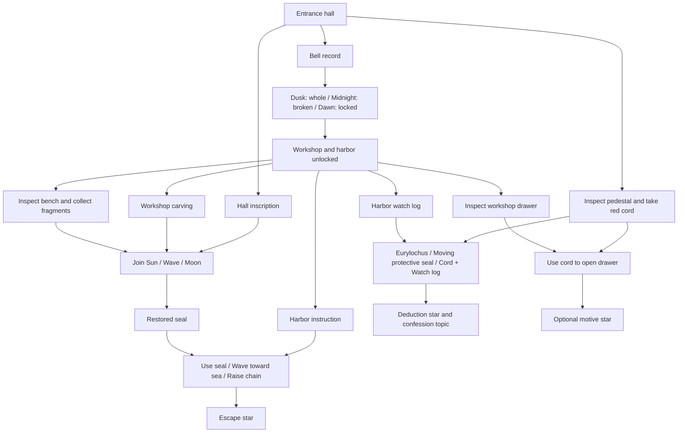

# Circe's Broken Seal: implemented case

Farshore's default mode is a mystery and escape case inspired by Book X of the Odyssey. The seal, records, message, locks, and puzzles are original fiction. The original fifteen-chapter advice game remains at `?voyage`; its save, cast book, and map are separate.

## Fixed truth and timeline

Circe leaves a whole protective seal on its pedestal at dusk. Between dusk and midnight, Eurylochus lifts it, hoping to open a side passage and free the crew. He drops it and it breaks. His three-knot red cord is trapped beneath the displaced stone. A watch keeper sees him carrying the seal and records that no one else entered before Odysseus arrived. Odysseus discovers the broken seal at midnight. The bell keeper records the harbor lock at dawn.

Eurylochus's motive is fear that Circe might transform the crew again. His unsent message documents this motive. The message alone does not establish that he actually moved the seal. The cord and independent watch record support that deduction.

| Witness | Knows | Available account |
| --- | --- | --- |
| Circe, hall | The seal's protective purpose, her dusk departure, and how to repair it | Says she left it whole. Directs the player to independent records and inscriptions. |
| Eurylochus, workshop | His action, accident, fear, and concealment | Initially claims he stayed near the ship and never touched the seal. Admits moving it after the supported deduction. Discusses his message after it is found. |
| Odysseus, harbor | What he found at midnight, the cord's owner, and the gate instructions | Does not claim to have seen the seal break. Recommends another account before accusing anyone. |

Witness statements and observations have separate journal labels. Finding a statement does not automatically prove a theory. Essential puzzle instructions are authored observations accessible without questioning any character.

## Clue and action dependencies

The hall is always revisitable. The harbor is reachable as soon as the timeline lock opens, even before seal restoration. Escape does not require a deduction or motive discovery; players can return after escape to complete those objectives. The cord remains available after opening the drawer. Incorrect answers preserve items and evidence. Repeated collection does not duplicate them.

## Exact star rules

| Star | Committed condition |
| --- | --- |
| Escape | Restore the seal using both inscriptions and the fragments. Read the harbor instruction. Use the restored seal with Wave facing the sea and Raise chain. |
| Prove what happened | Choose Eurylochus, moving the protective seal, and exactly two distinct collected clues: the three-knot cord and harbor watch log. |
| Optional motive | Inspect the workshop drawer and use the collected cord to reveal the unsent message. |

Hints, failed attempts, reading time, AI latency, wording, and clue-click counts do not affect stars. Objectives and the mystery question are displayed in the case screen. Unsupported theories explain what kind of corroboration is needed and allow revision.

## AI and recovery

Suggested questions return instant authored answers. Custom questions in authored mode use a labeled keyword match. Optional AI uses the configured chat-completions model to select a reply ID from the answers currently available to that witness. It does not generate the answer text. Unknown or unavailable IDs and additional result fields are rejected. The browser obtains the answer text and journal clue from the permitted authored reply, rather than accepting arbitrary network text.

Each request is limited to one active question, with a 90-second server deadline and a 95-second browser deadline. The interface shows elapsed wait, cancellation, and retry. Suggested questions remain usable during the wait and supersede the pending model request. Navigation, changing the witness, restarting, and switching AI settings cancel the request. A late response cannot commit progress after cancellation. Errors retain the question draft without an automatic authored substitution.

Case saves use `farshore-mystery-circe-v1`, preferences use `farshore-mystery-preferences`, and per-character drafts use `farshore-mystery-drafts-v1`. Reloads preserve the room, collected evidence, inventory, committed puzzle results, stars, and question drafts. Uncommitted puzzle selections reset. Save validation rejects malformed and inconsistent progress.

## Verification and remaining work

All 59 tests and the TypeScript/Vite production build passed on October 6. Checks cover full completion without AI, escape with one star, revisiting after escape, wrong answers, prerequisites, clue and item duplication, character knowledge, hints, save round trips, model schema validation, provider failure, and cancellation. The original voyage's regression tests are included in the full suite.

Reproduce with `npm.cmd test` and `npm.cmd run build`. With the local server and configured model running, record a separate smoke check with `node --experimental-strip-types scripts/verify-mystery.mjs http://localhost:5173 .tmp/mystery-live-ai-new.json`. Choose a fresh output filename to retain earlier results. The script does not change browser saves.

The [October 5 live-model smoke check](mystery-evidence/live-ai-2026-10-05.json) passed all three requests: gate purpose, seal repair, and a request to invent a key and award stars. End-to-end times were 20.093, 1.850, and 1.920 seconds. The first two selected the expected permitted answers; the third returned `unmatched`. The [October 1 check](mystery-evidence/live-ai-2026-10-01.json) also passed. These small checks do not establish general question-matching accuracy.

The [verification record](MYSTERY-VERIFICATION.md) distinguishes the October 1 desktop and phone-sized interactive checks from the later code and model checks, including three successful production-preview requests on October 6. No browser is connected to the October 6 or 7 sessions, so the latest UI adjustments have no fresh visual check. Actual newcomer research, full keyboard-only completion, real touch hardware, microphone checks, and peer critique remain uncollected.

Dedicated in-game dictation, generated character reactions, conversation memory, additional cases, and Challenge mode remain proposed. Device voice typing can fill the editable question box, but it was not exercised here. Phase 2 still documents the original voyage design and should be revised after the implemented case is evaluated.

For the next newcomer check, use a fresh case and ask the participant to state the escape goal and mystery question, explore without outside lore, explain why a witness account differs from an observation, and escape with a supported theory. Record completion, where help was needed, their explanation of the two supporting clues, and whether they understood which answers used AI. Then check an incorrect theory, a reload, and recovery from a cancelled or failed custom question. These are proposed tasks, with no participant findings recorded yet.
