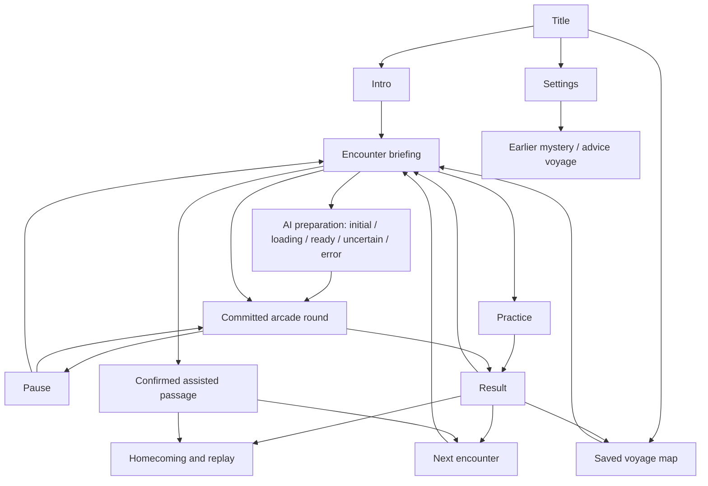

# Farshore: Trials of the Voyage

The October 8 arcade edition is the default game. Run `npm.cmd run dev`, open http://localhost:5173, and choose **Begin voyage**. The earlier mystery is at `?mystery` and the original advice voyage is at `?voyage`. All three modes use separate saves.

## Playable scope

| Encounter | Controls | Completion |
| --- | --- | --- |
| Cyclops' Coast | Left/Right or A/D; click or tap the movement buttons | Survive 45 seconds with fewer than three hits |
| Sirens' Passage | Space or Row during the visible gold window | Easy 6/8; Normal 9/12; Hard 13/16 |
| Ithaca's Bow | Space or Release when the sight's center crosses the gold opening | Easy 3/5; Normal 5/7; Hard 7/9 |

Each challenge has a briefing, short practice, Easy/Normal/Hard difficulty, countdown, pause, retry, streak feedback, and an assisted passage. Normal is the recommended default. The revision upgrades old difficulty preferences to Normal once while retaining sound, scenery, rival preferences, and campaign progress. Later difficulty selections persist. Practice does not change campaign records. Assistance is clearly recorded and can later be upgraded by clearing that encounter. Previous clears survive failed replays. The reunion epilogue completes the short voyage; other episodes are explicitly condensed.

Cyclops volleys block one or two lanes, always leaving open water. Their intervals shorten over the round; warnings are 1600/950/650 ms for Easy/Normal/Hard. Camping any lane loses. Sirens timing is ±350/160/100 ms and bow timing is ±300/120/75 ms. Higher difficulties also shorten each timing cycle and require more successes. These are authored values, not model decisions. Human difficulty calibration remains to be evaluated.

Cyclops uses a lane engine. The Sirens and bow share time-based hit checks but have distinct scenery and policies. Sirens beats can change cadence and reverse direction; the bow sight can reverse or change velocity. A throwing Cyclops, projectile arcs, locked red lanes, sea spray, a detailed rowing galley, Sirens and song waves, and a palace with twelve axes and flying arrows are rendered in code-native SVG. Essential positions use the same clock as the rules. Good and failed attempts get separate colored result marks and streak feedback. All essential cues are visible with sound off. Decorative water/oar movement respects Still scenery, while functional projectiles and sights remain visible. Keyboard movement remains usable after clicking a movement control. A pause freezes the simulation; a resume uses a new countdown. Hidden tabs, lost window focus, or frame gaps above 500 ms pause rather than skip warnings or stretch game time.

## AI integration

Both modes support all three difficulties. Difficulty determines reaction time and precision. The rival determines tactics:

| Trial | Standard pattern | AI policy catalog |
| --- | --- | --- |
| Cyclops | Repeating three-lane patrol | Lane hunter reads current lane habits; Crossfire changes the safe-route sequence |
| Sirens | Regular forward beat | Changing tide alternates fast/slow beats; Reverse echo changes direction and cadence |
| Bow | Constant-speed forward sight | Surging aim reverses direction; False release changes sight velocity |

Choose **AI rival**, then **Prepare AI rival**, to call the configured pretrained model. It selects one of that encounter's two AI policies using recent attempt summaries. Review the returned strategy and start it, regenerate it, change difficulty, or choose standard. The committed policy stays fixed. Local authored logic executes it during play; the lane hunter can read current lane occupancy, but each volley locks at its warning and never retargets afterward. This local adaptation is separate from pretrained model inference.

The browser sends the trial, difficulty, and at most two numeric summaries: hits, successful actions, early/late input, unplayed cues, and time spent in each lane. The server derives the lane or timing focus from those summaries and constrains the model to that single focus. The model chooses an AI policy and returns it with the required focus. The server rejects standard policies, wrong focus, extra fields, and unsupported IDs, then provides an authored description. It does not repair invalid output, generate story facts, or award progress.

No model calls occur during action. The server uses the existing `FARSHORE_MODEL_URL`, `FARSHORE_MODEL_NAME`, and optional server-only key. Local Ollama keeps inference on this laptop; a hosted configuration sends the disclosed summaries to that provider. No microphone, raw keystroke record, account, or cloud save is required.

Loading shows elapsed time and cancellation. Cancellation, navigation, practice, rival changes, pace changes, and restart invalidate pending preparation. A late reply cannot change a subsequent game. Errors and unsupported strategies offer retry or explicit standard play. There is no automatic AI-to-standard substitution and no invented confidence percentage.

See the [measured technical spike](technical-spike.md) and [current raw evidence](evidence/spike-challenge-focus-2026-10-08.json). The final six calls returned legal AI policies with the required focus, at 5.732-7.863 s end-to-end latency. This small local experiment establishes feasibility, not player enjoyment or general model quality.

## Information architecture

Content is deliberately separated by action: the map shows completion; the briefing shows story, objective, controls, pace, rival choice, and optional Homer notes; the game shows only active cues and status; the result shows what happened and the next action. Settings contains optional music, scenery, AI availability, and legacy links.

## Five task flows for a revised Phase 2 package

Persona references below use the existing Phase 1 sketches. They are provisional, not interview-backed personas.

1. **Start and learn (Daniel):** title -> two skippable cards -> Cyclops briefing -> practice -> practice result -> challenge. Practice does not spend progress or require AI.
2. **Prepare and control AI (Maya/Rosa):** select AI -> loading and elapsed time -> prepared strategy -> accept/start or regenerate. Cancellation returns to initial. Changing pace invalidates the candidate.
3. **Recover from a difficult round (Maya/Daniel):** result explains the miss -> retry, practice, slower pace, or confirmed assistance -> next encounter. No earlier clear is removed.
4. **Recover from AI failure (Rosa):** provider error, timeout, or invalid strategy -> visible reason -> retry or explicitly select standard -> playable round. No progress is awarded by a network reply.
5. **Resume and replay (Daniel/Maya):** reload -> continue -> saved map -> next unlocked encounter, or completed encounter replay -> authored result -> saved report.

The original Phase 2 PDFs and presentation still describe the advice voyage. This implementation record and the new spike support a revised packet, but they do not constitute a new complete wireframe set, revised presentation, peer critique, six interviews, or three research-backed personas.

## Files and checks

- `src/ArcadeApp.tsx`: screen flow, settings, save ownership, preparation, recovery, and homecoming.
- `src/components/arcade-round.tsx`: live input, rendering, pause, countdown, and practice.
- `src/components/arcade-scenes.tsx` and `src/arcade-scenes.css`: interactive SVG scenery and responsive game graphics.
- `src/lib/arcade.ts`: authored encounters, legal plans, pure rules, summaries, campaign progression, and save validation.
- `server/arcade.ts`: input/provider validation, bounded pretrained planning, and cancellation.
- `src/arcade.css`: scoped retro layout and responsive controls.
- `tests/arcade.test.mjs`: gameplay, progression, legal patterns, timing edges, saves, AI validation, and failures.
- `scripts/arcade-spike.mjs`: recorded real model calls and deliberately triggered failures.

Run `npm.cmd test` and `npm.cmd run build`. The spike refuses to overwrite its chosen evidence file. [Browser verification](verification.md) records the scope actually checked and the remaining human evaluation.
